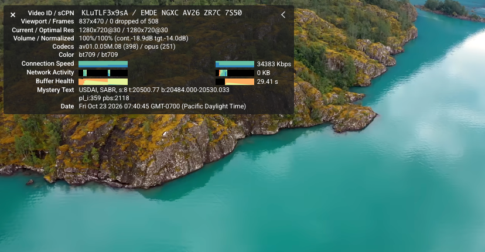

# YouTube Stat for Nerdest

A Tampermonkey script that folds YouTube’s **Stats for nerds** into a small display of whole-number Mbps and the current resolution (compatible with all Enhancer for Youtube themes).

**Compact**

**Expanded**

## Install

- You need [Tampermonkey](https://www.tampermonkey.net/) for your browser, skip if already have.
- [Install from GreasyFork](https://greasyfork.org/zh-CN/scripts/601793-youtube-nerdest)
- [Install from Github](https://raw.githubusercontent.com/livingfree2023/YoutubeNerdest/main/youtube-nerdest.user.js)

## Use

- **› / ‹** expands or collapses the stats with a smooth animation.
- In the collapsed view, click the resolution badge to cycle through available quality from highest down to 1080p; lower tiers are skipped.
- In the expanded panel, select an available resolution or **Auto**. High-resolution badges follow your Enhancer theme color, with red as the default. Optional low-resolution buttons appear when space allows.
- **×** closes the panel for the current video.
- Stats show automatically by default. Toggle **Show stats automatically** in Tampermonkey’s menu; your choice is saved.

Works on desktop YouTube. Keep Tampermonkey’s automatic updates enabled to receive new versions.

## License

[MIT](LICENSE)
